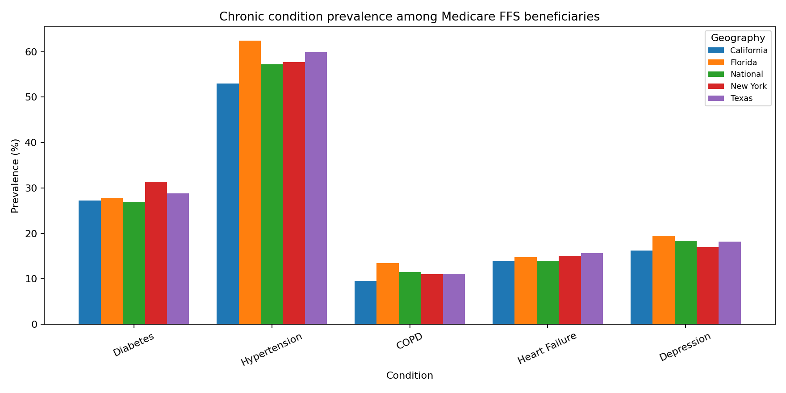
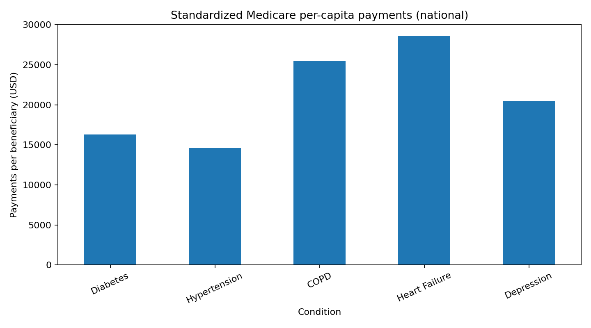
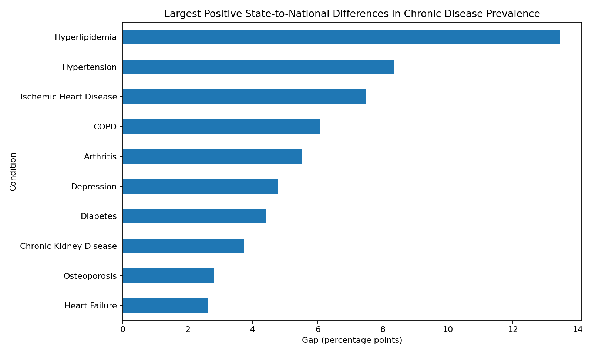

# Chronic Disease Burden and Medicare Utilization in the United States

**Python · Pandas · Matplotlib · Population Health Analytics**

## Overview

This project uses Python to analyze geographic variation in chronic disease prevalence and Medicare healthcare utilization among fee-for-service (FFS) beneficiaries in the United States.

The analysis examines 21 chronic conditions across national and state-level aggregates, with selected comparisons involving Texas, New York, California, and Florida.

It demonstrates the application of reproducible data processing, descriptive statistics, demographic stratification, and data visualization to population health analytics.

## The Healthcare Planning Question

How do chronic-condition prevalence and Medicare utilization vary across the United States, and how do Texas, New York, California, and Florida compare with national benchmarks?

The project approaches this question as a **descriptive healthcare planning exercise**, not a clinical prediction model or hospital staffing prescription.

## Project Objectives

1. Compare chronic-condition prevalence across national aggregates and four selected states.

2. Examine Medicare per-beneficiary payments, hospital readmission rates, and emergency department utilization.

3. Identify states with the highest and lowest reported prevalence for each condition.

4. Examine prevalence across race, sex, and age-specific demographic subgroups.

5. Generate reproducible analytical tables and visualizations to support interpretation and healthcare planning discussions.

## Tools and Technologies

- **Python:** Data processing and analytical workflows.

- **Pandas:** Data cleaning, filtering, aggregation, and descriptive analysis.

- **Matplotlib:** Data visualization.

- **Jupyter Notebook:** Interactive exploratory analysis.

- **CSV:** Structured data inputs and reproducible analytical outputs.

## Dataset

**Source:** Centers for Medicare & Medicaid Services (CMS), Multiple Chronic Conditions dataset provided for BMI 5007 as `chronic-disease-data.csv`.

**Population:** Medicare fee-for-service beneficiaries.

**Dataset size:** 32,340 aggregate observations covering 21 chronic conditions.

**Geographic coverage:** National and state-level data.

**Reporting period:** Pending verification against the original CMS release documentation.

The dataset contains aggregate population health measures rather than individual patient records. Accordingly, its prevalence estimates should not be generalized to the entire United States population.

## Analytical Approach

The analysis follows a reproducible workflow:

1. Import the CMS dataset and validate required columns.

2. Convert prevalence and utilization fields into appropriate numeric formats.

3. Select comparable national and state-level aggregate observations.

4. Convert prevalence proportions into percentages.

5. Calculate state-level prevalence extremes and differences from national benchmarks.

6. Extract demographic subgroup prevalence while preserving age, race, sex, and dual-status classifications.

7. Compare Medicare spending, hospital readmissions, and emergency department utilization.

8. Export analytical summaries and generate visualizations.

Missing utilization values are retained as missing rather than replaced with zeros.

## Key Findings

### 1. Chronic Disease Prevalence

Analysis of the CMS Multiple Chronic Conditions dataset identified substantial geographic variation in chronic disease prevalence among Medicare fee-for-service beneficiaries.

- **Hypertension:** The most prevalent of the 21 reported chronic conditions nationally, affecting 57.20% of beneficiaries. State-level prevalence ranged from 40.38% in Wyoming to 65.53% in Alabama.

- **Hyperlipidemia:** Exhibited the largest positive state-to-national prevalence difference. Delaware reported 61.10% prevalence compared with the national benchmark of 47.66%, a difference of 13.44 percentage points.

- **Ischemic heart disease:** Florida reported 34.28% prevalence compared with 26.81% nationally.

- **Chronic obstructive pulmonary disease (COPD):** Prevalence ranged from 6.58% in Hawaii to 17.55% in West Virginia, compared with 11.47% nationally.

- **Diabetes:** Prevalence reached 31.34% in New York compared with a national estimate of 26.95%.

These findings illustrate how population-level data can identify differences in chronic disease burden and support preliminary healthcare planning discussions.

### 2. Medicare Utilization and Spending

Medicare spending and healthcare utilization also varied across chronic conditions and geographic locations.

- **Medicare spending:** Stroke was associated with the highest national standardized Medicare per-capita spending among the 21 reported conditions ($31,881.96), followed by heart failure ($28,604.45). Among beneficiaries with stroke, Texas reported standardized spending of $37,209.25, approximately 16.7% above the national benchmark.

- **Hospital readmissions:** Beneficiaries with chronic viral hepatitis B and C had the highest reported national hospital readmission rate (30.36%), followed by HIV/AIDS (28.58%) and drug/substance abuse (27.78%).

- **Emergency department utilization:** Beneficiaries with drug/substance abuse had the highest national emergency department utilization (2,481.79 visits per 1,000 beneficiaries), followed by alcohol abuse (2,291.13 visits per 1,000 beneficiaries).

These measures describe healthcare utilization among beneficiaries with the specified conditions and should not be interpreted as spending or services attributable exclusively to those conditions.

### 3. Demographic and Age-Stratified Analysis

The project also examines chronic disease prevalence across demographic subgroups.

The age-stratified dataset contains **378 national aggregate records** across two age categories:

- Under 65 years (`<65`)

- 65 years and older (`65+`)

These records are distributed across race, sex, and Medicare dual-eligibility classifications.

| Demographic category | Under 65 |     65+ |   Total |

| :------------------- | -------: | ------: | ------: |

| Race                 |      105 |     105 |     210 |

| Sex                  |       42 |      42 |      84 |

| Dual Status          |       42 |      42 |      84 |

| **Total**            |  **189** | **189** | **378** |

The analysis preserves demographic subgroup identifiers rather than combining overlapping populations.

Consequently, these 378 records represent age-specific demographic aggregates, **not 378 unique beneficiaries or independent patient observations**.

### 4. Interpretation and Healthcare Planning Implications

The findings demonstrate the potential value of descriptive population health analytics for identifying geographic differences in chronic disease burden and healthcare utilization.

These analyses can support preliminary discussions about:

- Healthcare service needs and specialist capacity.

- Care coordination and chronic disease management.

- Hospital utilization and resource planning.

- Geographic disparities in reported chronic disease prevalence.

- Opportunities for further population health and healthcare quality research.

However, these findings should be interpreted cautiously.

Geographic comparisons are descriptive and unadjusted. Differences in beneficiary demographics, comorbidities, population composition, and healthcare utilization patterns may contribute to observed variation.

Associations in aggregate data do not establish causality and do not provide sufficient evidence for specific hospital staffing or policy recommendations.

Further analyses using appropriate adjustment methods would be necessary before drawing operational conclusions.

## Visualizations

### Figure 1. Chronic Disease Prevalence Across Selected States



Comparison of selected chronic conditions across national, Texas, New York, California, and Florida aggregates.

### Figure 2. Standardized Medicare Spending



National standardized Medicare per-capita payments for five selected chronic conditions: diabetes, hypertension, COPD, heart failure, and depression.

### Figure 3. State-to-National Prevalence Differences



The ten largest positive differences between the highest reported state prevalence and the corresponding national prevalence, measured in percentage points.

## Data Interpretation and Limitations

Several considerations are important when interpreting the results.

- **Population:** The estimates apply to Medicare fee-for-service beneficiaries, not the entire United States population.

- **Unit of analysis:** Each observation represents an aggregate defined by geography, condition, and demographic or age classification.

- **Prevalence:** The `Prvlnc` field contains a decimal proportion. Values are multiplied by 100 to express percentages.

- **Medicare spending:** Per-capita payments describe healthcare spending among beneficiaries with a condition, including services associated with coexisting illnesses.

- **Healthcare utilization:** Readmission rates and emergency department visit rates should not be interpreted as utilization caused exclusively by the reported chronic condition.

- **Demographic stratification:** Age-specific observations are preserved alongside their race, sex, or dual-status categories. Overlapping demographic groups are not combined to generate overall age prevalence estimates.

- **Missing values:** Missing and suppressed data are not treated as zeros.

- **Geographic comparisons:** State-level findings are descriptive and have not been adjusted for demographic or clinical differences.

- **Geographic exclusions:** The District of Columbia, Puerto Rico, and the Virgin Islands are excluded from 50-state prevalence extremes where present.

- **Reporting period:** The dataset's reporting year must be confirmed from the original CMS release metadata before making time-specific claims.

## Project Structure

```text

01-population-health-analytics/

|

|-- data/

|   |-- chronic-disease-data.csv

|

|-- notebooks/

|   |-- chronic_disease_analysis.ipynb

|

|-- src/

|   |-- analyze.py

|

|-- figures/

|   |-- prevalence_selected_conditions.png

|   |-- medicare_spending.png

|   |-- state_prevalence_gap.png

|

|-- outputs/

|   |-- condition_prevalence_by_geography.csv

|   |-- medicare_utilization.csv

|   |-- prevalence_by_age.csv

|   |-- prevalence_by_race.csv

|   |-- state_prevalence_extremes.csv

|   |-- state_prevalence_extremes_by_race.csv

|   |-- state_prevalence_extremes_by_sex.csv

|

|-- requirements.txt

|-- README.md

```

## Run Locally

### 1. Install Dependencies

From the project directory, install the required Python packages:

```bash

pip install -r requirements.txt

```

### 2. Run the Analysis

```bash

python src/analyze.py

```

The script reads `data/chronic-disease-data.csv`, produces seven summary CSV files under `outputs/`, and generates three PNG figures under `figures/`.

### 3. Explore the Jupyter Notebook

Open:

```text

notebooks/chronic_disease_analysis.ipynb

```

Select a compatible Python environment and execute the notebook cells in sequence.

## Generated Outputs

The analysis has been executed successfully against the supplied dataset.

### Analytical Tables

| Output file                             | Records |

| :-------------------------------------- | ------: |

| `condition_prevalence_by_geography.csv` |     105 |

| `medicare_utilization.csv`              |     105 |

| `prevalence_by_age.csv`                 |     378 |

| `prevalence_by_race.csv`                |     105 |

| `state_prevalence_extremes.csv`         |      21 |

| `state_prevalence_extremes_by_race.csv` |     105 |

| `state_prevalence_extremes_by_sex.csv`  |      42 |

### Figures

- `prevalence_selected_conditions.png`

- `medicare_spending.png`

- `state_prevalence_gap.png`

All seven CSV outputs contain data, and all three figures have been generated.

## Skills Demonstrated

- Healthcare data preprocessing and validation.

- Descriptive population health analytics.

- Geographic and demographic stratification.

- Medicare spending and utilization analysis.

- Data cleaning and missing-value handling.

- Python-based data visualization.

- Reproducible analytical workflows.

- Interpretation of aggregate healthcare data.

- Scientific and technical documentation.

## Origin and Scope

This project was adapted and independently organized from the author's **BMI 5007: Chronic Disease Analysis — Parts 1 and 2** coursework.

The original coursework submissions are maintained separately. This repository provides a reproducible professional presentation of descriptive population health analytics rather than peer-reviewed research findings.

Before public redistribution, the original CMS dataset release metadata, reporting period, and applicable data redistribution terms should be confirmed.
